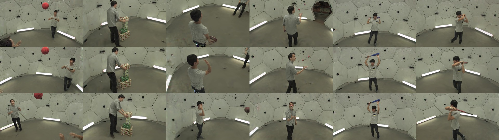
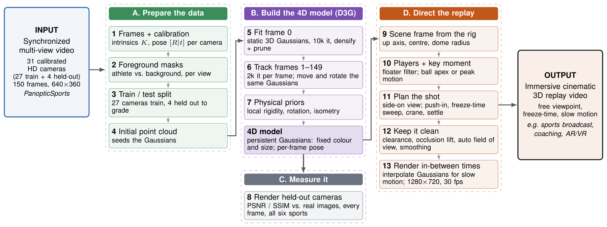

# Open Free-Viewpoint Reconstruction of Athletes with Dynamic 3D Gaussians

Turn synchronized multi-angle video of an athlete into a cinematic 3D replay: a free viewpoint, slow motion
and a freeze-time sweep, with the camera move planned automatically. Built on
[Dynamic 3D Gaussians](https://github.com/JonathonLuiten/Dynamic3DGaussians) (Luiten et al., 3DV 2024) and
tested on the PanopticSports clips. CS 6501 3D Computer Vision (UVA, Fall 2026) course project.



## How it works



| Stage | Steps | What comes out |
|---|---|---|
| A. Prepare the data | 1 frames + calibration, 2 foreground masks, 3 train/test split (27/4 cameras), 4 starting point cloud | 31 synced, calibrated views per frame |
| B. Build the 4D model | 5 fit frame 0, 6 track frames 1–149, 7 physical priors (rigidity, rotation, isometry) | Gaussians that persist and move over 150 frames |
| C. Measure it | 8 render the 4 held-out cameras, PSNR/SSIM | quality on views the model never saw |
| D. Direct the replay | 9 scene frame from the rig, 10 players + key moment, 11 shot plan, 12 clearance/occlusion/lens, 13 render in-between times | a 17 s replay at 1280×720, 30 fps |

Each step and its intermediate output is described in [docs/pipeline.md](docs/pipeline.md).

## Results so far

| Clip | Model | Held-out PSNR | SSIM | Freeze frame | Replay jerk (median) |
|---|---|---|---|---|---|
| basketball | ours | 27.03 | 0.891 | 59 | 0.020 |
| boxes | released | 29.01 | 0.899 | 75 | 0.005 |
| football | released | 29.03 | 0.903 | 75 | 0.008 |
| juggle | released | 29.28 | 0.908 | 50 | 0.013 |
| softball | released | 28.78 | 0.904 | 81 | 0.015 |
| tennis | released | 28.60 | 0.904 | 49 | 0.015 |

A naive orbit that blends the real camera poses has a median jerk of 0.704 (35× higher). Details:
[results/](results/) and the [mid-term report](report/midterm/main.pdf).

## Repository layout

```
src/            shared code: sparse_lib.py (wraps D3G training/eval/render), cine_path.py (replay director)
scripts/        entry points: train_sparse.py, render_cinematic.py, render_videos.py, stage_figs.py, ...
hpc/            config, Slurm jobs, replica setup + verify, env spec, D3G patch, sync helpers (UVA HPC)
tools/          compose_figures.py (report/slide figures), workflow.tex (workflow diagram)
report/midterm/ CVPR-style mid-term report (LaTeX source + PDF)
slides/midterm/ source of the mid-term slide deck
results/        small result tables (CSV/JSON) and logs
docs/           pipeline walkthrough, HPC guide, images
data/           how to get the datasets (contents not tracked)
media/          videos, frames, full stage figures (not tracked; too large for git)
```

## Running it

Everything heavy runs on a GPU cluster with Slurm; see [docs/hpc.md](docs/hpc.md). A fresh copy of the whole setup is built with
`bash hpc/setup_replica.sh` and checked with `hpc/verify_replica.py`. Then, from the repo root on the cluster:

```
sbatch hpc/jobs.slurm full basketball 27 allcam     # train the 4D model (~3 h)
bash   hpc/submit_v6.sh                             # cinematic replay for all six clips
sbatch hpc/jobs.slurm figs                          # intermediate-output figures + held-out scores
```

Then locally: `python tools/compose_figures.py` and build `report/midterm/main.tex` with pdflatex + bibtex.

## Credits

Dynamic 3D Gaussians and PanopticSports by Luiten, Kopanas, Leibe and Ramanan; CMU Panoptic Studio by Joo et al.;
3D Gaussian Splatting by Kerbl et al. The five non-basketball replays use the D3G authors' released models.
Inspiration: World Labs' Atlas, Arcturus, Roboflow, @mirrash7 and @sdmiddlecamp (see the report).
