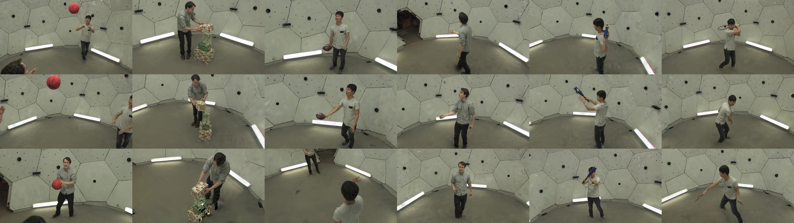

# Open Free-Viewpoint Reconstruction of Athletes with Dynamic 3D Gaussians

Turn synchronized multi-angle video of athletes into a cinematic 3D replay: a free viewpoint, slow motion and a
freeze-time sweep, with the camera move planned automatically, and every step measured against real held-out
views or motion capture. Built on [Dynamic 3D Gaussians](https://github.com/JonathonLuiten/Dynamic3DGaussians)
(Luiten et al., 3DV 2024) and tested on the six PanopticSports clips. CS 6501 3D Computer Vision (UVA, Fall 2026).



## How it works


| Stage | Steps | Code |
|---|---|---|
| A. Prepare the data | 1 calibration, 2 masks, 3 train/test split, 4 starting point cloud | `pipeline/common/sparse_lib.py` |
| B. Build the 4D model | 5 fit frame 0, 6 track frames 1–149, 7 physical priors | `pipeline/1_reconstruct/` |
| C. Measure it | 8 held-out PSNR/SSIM, skeleton alignment, 3D track error | `pipeline/2_evaluate/` |
| D. Direct the replay | 9 scene frame, 10 players + key moment (A), 11 shot plan (B), 12 clearance/occlusion/lens, 13 cubic render (C) | `pipeline/3_director/` |

Every step with its input, output and intermediate figure: [docs/pipeline.md](docs/pipeline.md).
The three final-project additions and every experiment: [docs/experiments.md](docs/experiments.md).

## Results (all six models trained by us)

| Clip | Held-out PSNR | SSIM | Median track error |
|---|---|---|---|
| basketball | 27.03 | 0.891 | 3.7 cm |
| boxes | 28.70 | 0.902 | 3.5 cm |
| football | 27.88 | 0.899 | 2.0 cm |
| juggle | 28.67 | 0.907 | 2.0 cm |
| softball | 28.43 | 0.903 | 3.1 cm |
| tennis | 27.78 | 0.903 | 5.2 cm |

Cubic in-between frames beat a straight-line blend in every sport (+1.0 dB on the athlete at gap 8), the
skeleton key moment lands a median 10 frames from a hand label (51 for the old ball rule), and the facing-aware
path cuts back views by up to a third. Full tables in [results/](results/) and the
[final report](report/final/main.pdf).

## Repository layout

```
pipeline/                 all the code, in the order it runs
  common/                 shared: sparse_lib.py (D3G training/eval/render), skeleton.py, interp.py
  1_reconstruct/          train_sparse.py (the 4D model); sweep_frame0.py, plot_sweep.py (mid-term study)
  2_evaluate/             stage_figs.py (held-out scores + stage figures), align_skeletons.py, eval_tracks.py,
                          eval_interp.py, analysis.py, contact_sheets.py
  3_director/             cine_path.py (the director), director_metrics.py, render_cinematic.py,
                          render_videos.py, ablate_director.py
  figures/                final_figures.py, compose_figures.py (mid-term), workflow.tex
cluster/                  UVA HPC: config, Slurm jobs, run_role.sh, submit scripts, environment, D3G patch
results/                  small result tables (CSV/JSON), grouped by pipeline stage; midterm/ kept apart
report/                   midterm/ and final/ CVPR-style reports (LaTeX + PDF + Overleaf zip)
slides/                   mid-term deck source and links to the final decks
docs/                     pipeline walkthrough, cluster guide, experiment plan
data/                     how to get PanopticSports and the skeletons (contents not in git)
outputs/                  videos and full-size figures from the cluster (not in git)
```

## Running it

Everything heavy runs on a GPU cluster with Slurm; see [docs/hpc.md](docs/hpc.md). From the repo root on the cluster:

```
bash   cluster/setup_replica.sh                                         # one-time setup
bash   cluster/submit_final.sh                                          # every final experiment
sbatch cluster/jobs.slurm full basketball 27 allcam                     # train one 4D model (~3 h)
sbatch cluster/jobs.slurm cine basketball n27_allcam --variant full     # render one replay
sbatch cluster/cpu.slurm ablate n27_allcam                              # director ablation (CPU)
```

Locally: `make figures` rebuilds the report figures from `outputs/`, `make report` builds the PDF, and
`make overleaf` packs the report for Overleaf.

## Credits

Dynamic 3D Gaussians and PanopticSports by Luiten, Kopanas, Leibe and Ramanan; CMU Panoptic Studio by Joo et al.;
3D Gaussian Splatting by Kerbl et al. Inspiration: World Labs' Atlas, Arcturus, @mirrash7 and @sdmiddlecamp.
