# From synchronized video to a 3D replay, step by step

Basketball clip shown throughout. Step numbers match the workflow diagram.

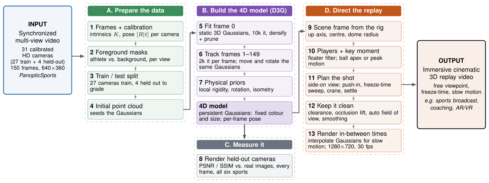

## A. Prepare the data

**1. Frames and calibration.** Load every frame with its camera's intrinsics and pose. Rendering into a camera
only works if these are exact. Out: 31 synchronized, calibrated views per frame.

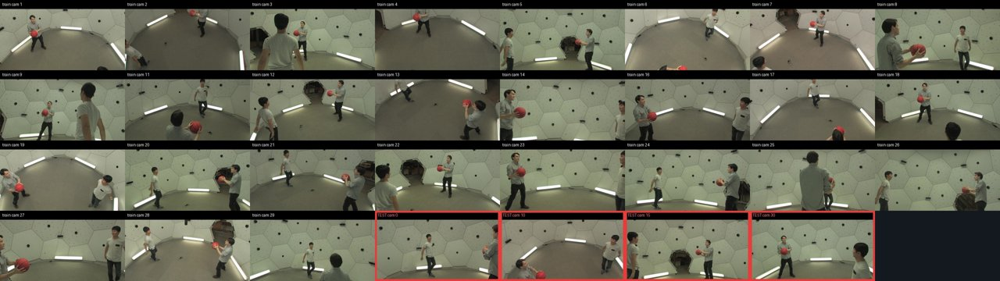

**2. Foreground masks.** One mask per image separates the athlete from the dome. D3G uses it to give each
Gaussian an athlete-or-background label; the director later uses that label to find the players.

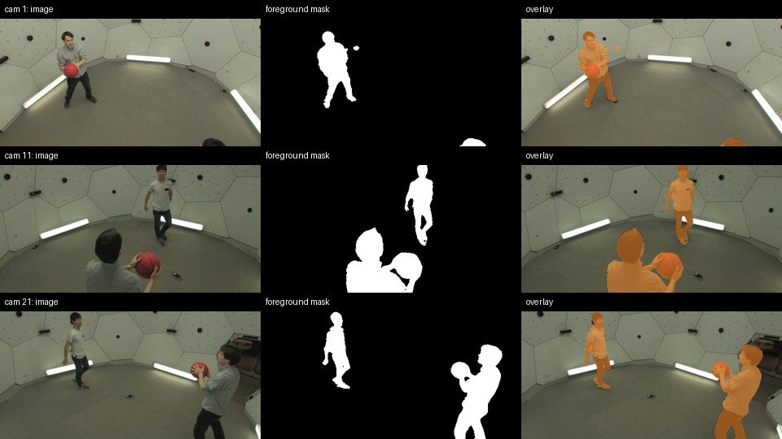

**3. Train/test split.** 27 cameras train the model. The other 4 are never used for training and only grade it.

**4. Starting point cloud.** Each Gaussian starts at one of the 194k points of the released cloud, with its colour and label.

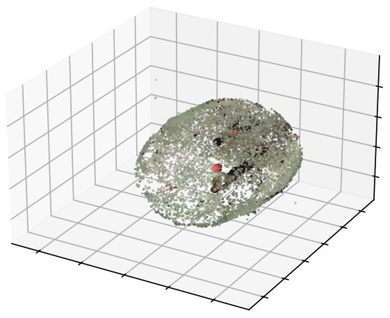

## B. Build the 4D model (Dynamic 3D Gaussians)

**5. Fit frame 0** like static 3D Gaussian Splatting: 10k iterations, image + mask loss, Gaussians split, cloned
and pruned. Before training the held-out view is a grey blur; after 500 iterations it is at 27.9 dB; the cloud
grows from 194k to about 365k Gaussians.

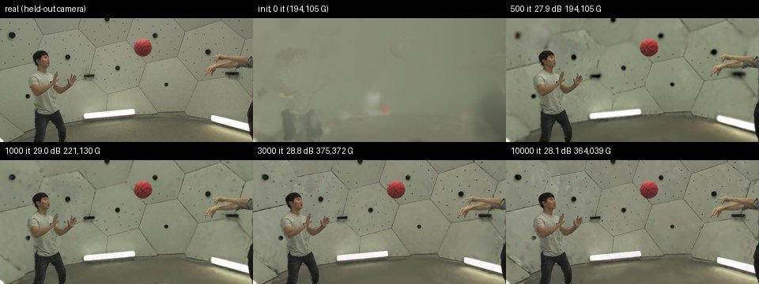

**6. Track frames 1–149.** Each frame starts from the last and gets 2k iterations. Colour, size and opacity stay
fixed; only position and rotation change. **7. Physical priors** keep neighbours moving rigidly, rotating together
and keeping their distances. Out: a 4D model with a 3D track for every point.

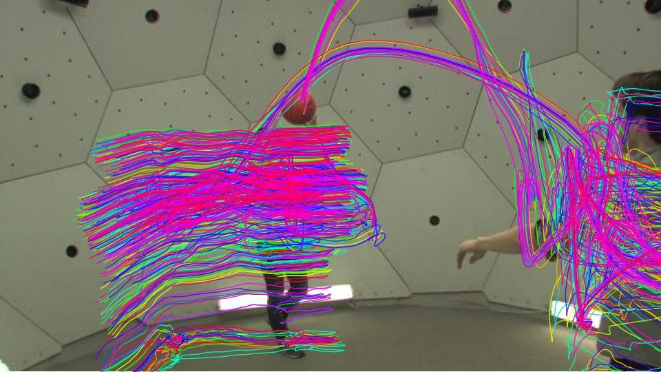

## C. Measure it

**8. Held-out evaluation.** Render the 4 held-out cameras every frame and compare with the real images (PSNR, SSIM).
The model also gives depth and athlete labels.

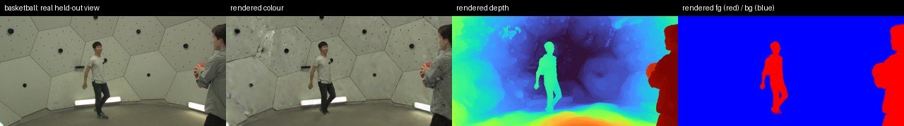
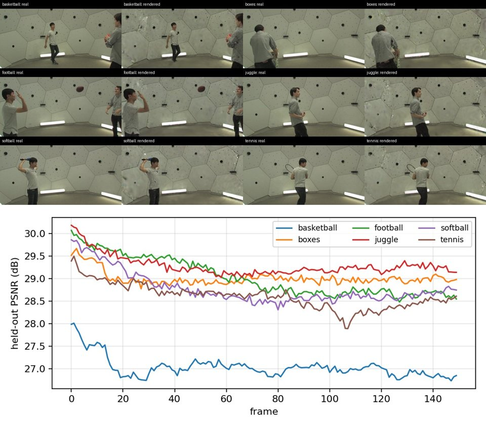

## D. Direct the replay (`src/cine_path.py`)

**9. Scene frame.** From the camera rig alone: up direction, the point all optical axes meet, dome radius, camera heights.

**10. Players and key moment.** Players are dense clusters of athlete Gaussians (loose floaters removed). The freeze
frame is the ball's highest point if red "ball" Gaussians exist, otherwise the peak player speed.

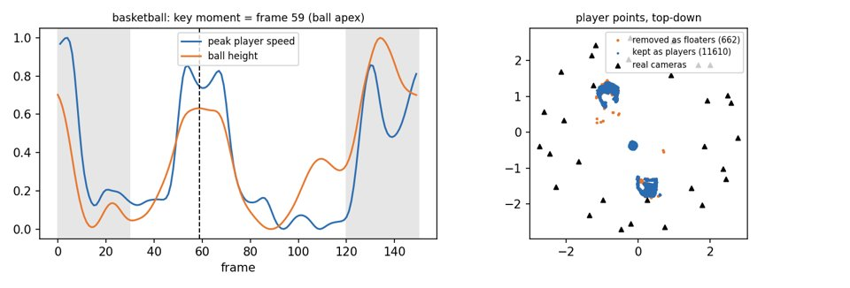

**11. Shot plan.** Look across the main motion (side-on), then fly a push-in, a 5 s freeze-time sweep of 130°, a crane
and a settle. **12. Keep it clean:** stay at least 0.35 dome radii from every player, rise if someone blocks the view,
widen the lens to fit the play, smooth the aim twice.

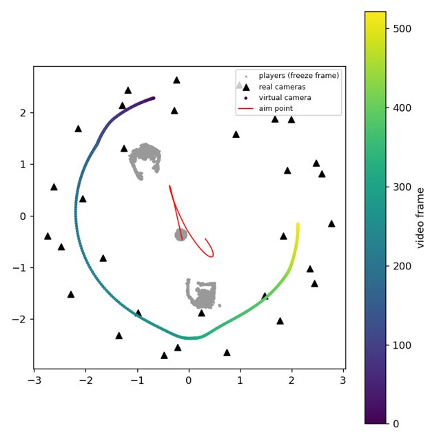
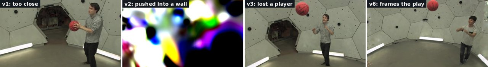

**13. Render in-between times.** For slow motion (0.4×) and the freeze, blend each Gaussian's position, colour and
rotation between frames, so no frame repeats. Out: 17 s at 1280×720, 30 fps (`scripts/render_cinematic.py`).

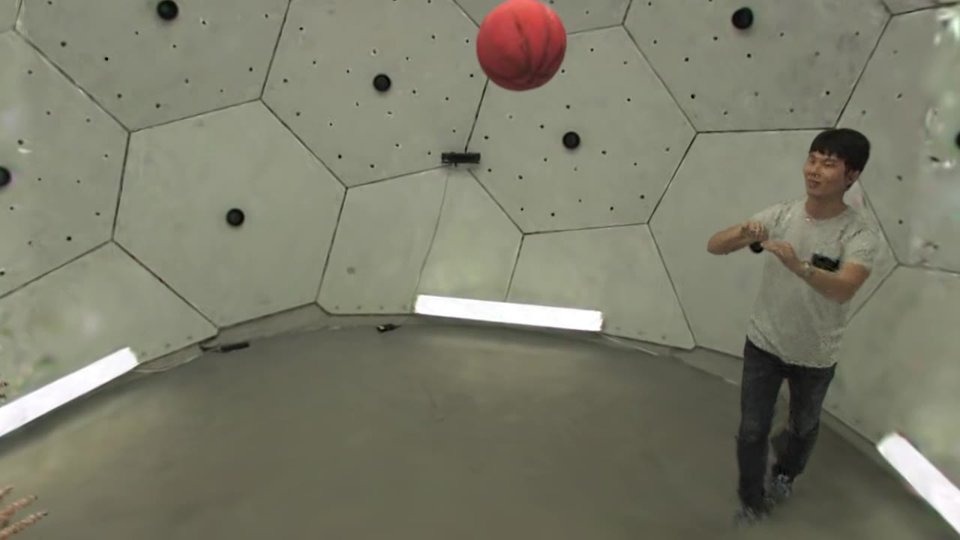
